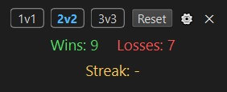
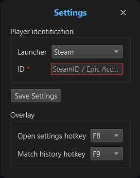
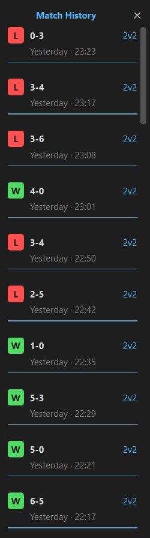
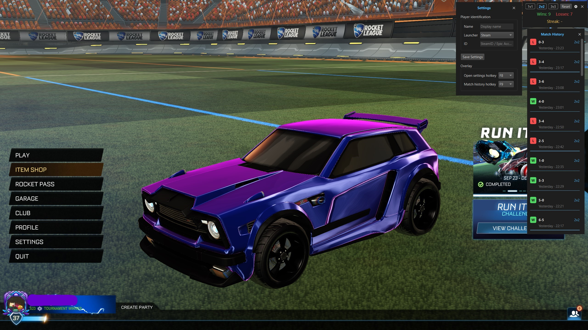

  

  <h1 align="center">OMNX - A Rocket League Overlay </h1>

  <a href="https://github.com/byEnok/rl-overlay/releases">Download Latest Release</a>

 

  

  
<strong>Table of Contents</strong>

    <!-- <ol style="list-style-position: outside; padding-left: 2%; inline-block; text-align: left;"> -->
    <!-- <ol style="display: table; margin: 0 auto; padding-left: 25px; text-align: left;"> -->
    <ol style="list-style-position: inside; padding-left: 2%; text-align: left;">
        <li><a href="#installation">Installation</a></li> 
        <li><a href="#features">Features</a></li> 
        <li><a href="#recording-match-results">Recording Match Results</a></li> 
        <li><a href="#windows">Windows</a></li>
        <li><a href="#setup">Setup</a></li>
        <li><a href="#screenshots">Screenshots</a></li>
        <li><a href="#troubleshooting">Troubleshooting</a></li>
        <li><a href="#privacy">Privacy</a></li>
    </ol>
  

  
 

 
  <h3>Track your wins, losses, win streaks and last 50 ranked matches with a lightweight, easy-to-use overlay</h3>

 

## Installation

### OMNX does not require installation. 

Download the latest release and run OMNX.exe.

Once started, OMNX runs in the background and tracks your Rocket League matches while displaying your statistics through the overlay. You can close OMNX at any time from the **session window** or **system tray**.

 

### Windows Security Warning

When running OMNX for the first time, Windows may display a "Windows protected your PC" warning because the application is not yet recognized by Microsoft SmartScreen.

If you downloaded OMNX from the official GitHub Releases page and want to proceed:

Click More info.

Click Run anyway.

This warning may appear because OMNX does not yet have an established reputation with Microsoft SmartScreen and is not signed with a code-signing certificate.

 

## Features
- **W/L Tracking** - Track wins and losses in **Ranked** 1v1, 2v2 and 3v3

- **Win streaks** - Keep track of your current streak

- **Match history** - View your 50 most recent ranked matches, including results, final scores and timestamps

- **Persistent Statistics** – Your match history and statistics are saved between application restarts

- **Custom Hotkeys** – Open Settings and Match History using configurable keyboard shortcuts

- **Movable Windows** – Position the overlay windows wherever you prefer with a simple drag and drop

- **Session Reset** – Reset your session statistics without deleting your match history

- **Local Storage** – Your data stays on your computer.
  
- **Quit from Session Window** – Close OMNX using the "X" button in the session window.

- **System Tray** – Quit OMNX directly from its system tray icon.

 

## IMPORTANT
### Recording Match Results
OMNX records a match result when Rocket League displays the final victory screen showing which team won.

Do not leave the match immediately after a forfeit. Wait until the final victory screen appears, even if there's a replay to watch. If you leave before this screen appears, OMNX may not record the match result.

 

## Windows
 - Session - View your current W/L statistics and win streaks
 - Settings - Configure your launcher ID and hotkeys.
 - Match history - Browse your 50 most recent ranked matches.

 

## Setup

### **1. Configure Rocket League**

- Locate your Rocket League installation folder and open:
  - rocketleague\TAGame\Config\DefaultStatsAPI.ini

- Add or update these lines:
  - **PacketSendRate=1**
  - **Port=49123**

**Save the file** before exiting and don't launch Rocket League yet.

 

### **2. Configure Your Launcher & Player ID**

- Open OMNX, go to Settings, and select the launcher you use to play Rocket League.
- - Enter the player ID for your selected launcher:
  - **Steam** – Your 17-digit Steam ID (e.g: 76561197960287930)
  - **Epic Games** – Your Epic Games Account ID (e.g: 3444634fab9a427ab453d4d232aad97e)

**Remember to save your settings!**

 

**IMPORTANT!**

Complete Steps 1 and 2 before launching Rocket League. Make sure you've saved both the configuration file and your OMNX settings.

 

### **3. Configure Display Mode**

- You can now launch Rocket League.

- Set Rocket League's display mode to Borderless so the overlay can appear over the game.

- If you prefer exclusive fullscreen, you can keep that and just place the overlay on a Second Monitor.

 <!-- Once setup is complete, you can launch Rocket League and OMNX in any order. -->

(<a href="#readme-top">back to top</a>)

 

# Screenshots
<table align="center" border="0" >
  <tr>
    <td align="center" valign="top">
      <h3>Session</h3>
      
      <h3>Settings</h3>
      
    </td>
  <td width="200"></td>
    <td align="center" valign="top">
      <h3>Match History</h3>
      <!--  -->
      
    </td>
  </tr>
</table>

(<a href="#readme-top">back to top</a>)

 

<a href="https://github.com/byEnok/rl-overlay/releases">Download Latest Release</a>

# Troubleshooting

### **If OMNX does not track your matches:**
- Verify that the **correct** launcher ID is configured.

- Check that DefaultStatsAPI.ini contains the required settings.

- Restart Rocket League after changing the configuration file
  
- Restart Rocket League after updating OMNX settings

- Make sure you are playing **Ranked** 1v1, 2v2, or 3v3.

 

# Privacy

### OMNX is designed to run locally.
 - No data transmission: Your match history and statistics are never uploaded or sent to external servers.
 - Local data storage: Match history, statistics, and application settings are stored on your computer and persist between restarts.
 - On Windows, your data is stored in C:\Users\<username>\AppData\Local\OMNX\overlay.db.

(<a href="#readme-top">back to top</a>)

